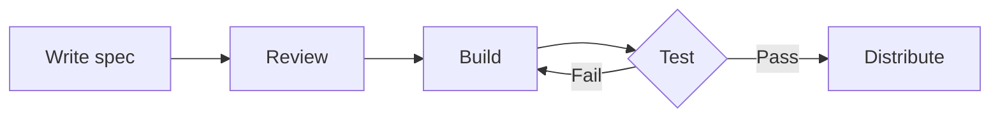
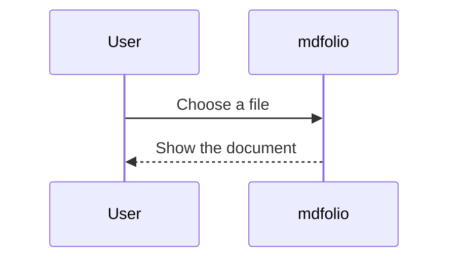

# mdfolio sample (single file)

This one file is enough to try how mdfolio displays documents. The Japanese version is `sample.md`. Choose this file with "Open files" in mdfolio, or drop it onto the window.

Features that work across a folder (links between documents, images, sidebar order, full-text search) can be tried with the samples in the `sample-docs-en` folder.

## Using the outline

"On this page" appears on the right (above the text on a narrow screen). Choose a heading to jump to it. You can also link to headings from the text, like [Code](#code) or [Diagrams](#diagrams).

## Text styles

You can use **bold**, *italic*, ~~strikethrough~~, `inline code`, and keys such as <kbd>Ctrl</kbd> + <kbd>K</kbd>.

End a line with two spaces  
to break the line.

## Lists

- Bullet list
  - Nested item
  - Another one
- Second item

1. Numbered
2. Second

### Task list

- [x] Write the spec
- [x] Review it
- [ ] Distribute it

## Tables

| Feature | Supported | Notes |
|:---|:---:|---:|
| Tables | ✓ | Columns can be aligned left, center or right |
| Math | ✓ | KaTeX |
| Diagrams | ✓ | Mermaid |

## Quotes and alerts

> This is a quote.
> It can span several lines.

> [!NOTE]
> A note. Something readers should know.

> [!TIP]
> A tip.

> [!IMPORTANT]
> Important information.

> [!WARNING]
> A warning.

> [!CAUTION]
> A caution. Use it for actions that cannot be undone.

## Code

Add a language name to color the code. Press "Copy" at the top right to copy it.

```js
// Count the Markdown files in a folder
function countDocs(files) {
  return files.filter((name) => /\.md$/i.test(name)).length;
}
console.log(countDocs(['README.md', 'guide.md', 'logo.png'])); // 2
```

```python
def greet(name: str) -> str:
    """Return a greeting"""
    return f"Hello, {name}"
```

```powershell
Get-ChildItem -Recurse -Filter *.md | Measure-Object
```

## Math

Write math inline, like $E = mc^2$. Put a display equation between `$$` lines.

$$
\int_0^1 x^2 \, dx = \frac{1}{3}, \qquad
\sum_{k=1}^{n} k = \frac{n(n+1)}{2}
$$

Prices such as $5 and $10 are not treated as math.

## Diagrams





## Footnotes

Footnotes are collected at the end of the document[^1]. The same footnote can be referred to many times[^1].

[^1]: This is a footnote.

## Collapsible sections

<details>
<summary>Click to open</summary>

You can write **Markdown** inside a collapsible section too.

</details>

## Links

- To a heading on this page: [Text styles](#text-styles)
- To an external site (opens in a new tab): [CommonMark](https://commonmark.org/)
