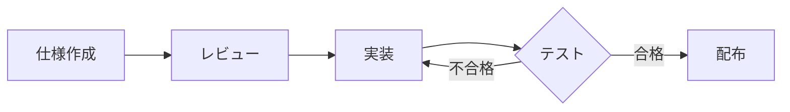
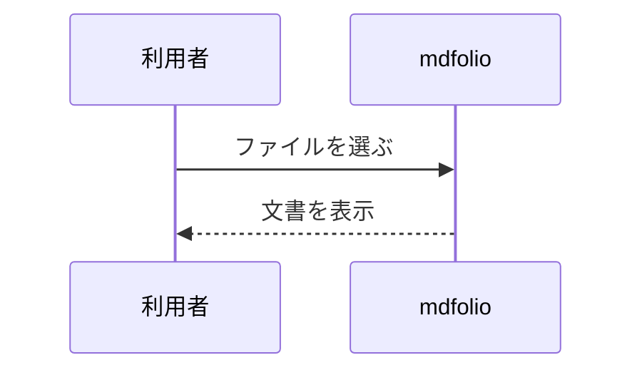

# mdfolio サンプル（1 ファイル版）

このファイル 1 つだけで、mdfolio の表示を試せます。mdfolio の「ファイルを開く」でこのファイルを選ぶか、ウィンドウにドロップしてください。

フォルダ単位の機能（文書どうしのリンク、画像、サイドバーの並び、全文検索）は、`sample-docs` フォルダのサンプルで試せます。英語版は `sample.en.md` です。

## 目次の使い方

画面の右（狭い画面では本文の上）に「このページの目次」が出ます。見出しを選ぶと、その位置へ移動します。本文中からも [コード](#コード) や [図](#図) のように、見出しへリンクできます。

## 文字の装飾

**太字**、*斜体*、~~打ち消し線~~、`インラインコード`、<kbd>Ctrl</kbd> + <kbd>K</kbd> のようなキー表記が使えます。

行末に空白を 2 つ置くと  
改行されます。

## リスト

- 箇条書き
  - 入れ子の項目
  - もう 1 つ
- 2 つ目

1. 番号付き
2. 2 番目

### タスクリスト

- [x] 仕様を書く
- [x] レビューする
- [ ] 配布する

## 表

| 機能 | 対応 | 備考 |
|:---|:---:|---:|
| 表 | ○ | 列ごとに左・中央・右に揃えられる |
| 数式 | ○ | KaTeX |
| 図 | ○ | Mermaid |

## 引用と補足

> 引用文です。
> 複数行にわたって書けます。

> [!NOTE]
> 補足です。読み手に知っておいてほしいことを書きます。

> [!TIP]
> ヒントです。

> [!IMPORTANT]
> 重要な情報です。

> [!WARNING]
> 警告です。

> [!CAUTION]
> 注意です。取り消せない操作などに使います。

## コード

言語名を付けると色分けされます。右上の「コピー」でコードをコピーできます。

```js
// フォルダ内の Markdown を数える
function countDocs(files) {
  return files.filter((name) => /\.md$/i.test(name)).length;
}
console.log(countDocs(['README.md', 'guide.md', 'logo.png'])); // 2
```

```python
def greet(name: str) -> str:
    """あいさつを返す"""
    return f"こんにちは、{name} さん"
```

```powershell
Get-ChildItem -Recurse -Filter *.md | Measure-Object
```

## 数式

文中に $E = mc^2$ のように書けます。独立した式は `$$` で囲みます。

$$
\int_0^1 x^2 \, dx = \frac{1}{3}, \qquad
\sum_{k=1}^{n} k = \frac{n(n+1)}{2}
$$

金額の表記（$5 と $10 など）は数式として扱われません。

## 図





## 脚注

脚注は本文の末尾にまとめて表示されます[^1]。同じ脚注を何度でも参照できます[^1]。

[^1]: これが脚注です。

## 折りたたみ

<details>
<summary>クリックで開く</summary>

折りたたみの中にも **Markdown** が書けます。

</details>

## リンク

- ページ内の見出しへ: [文字の装飾](#文字の装飾)
- 外部のサイトへ（新しいタブで開きます）: [CommonMark](https://commonmark.org/)
