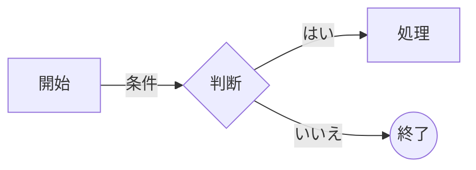
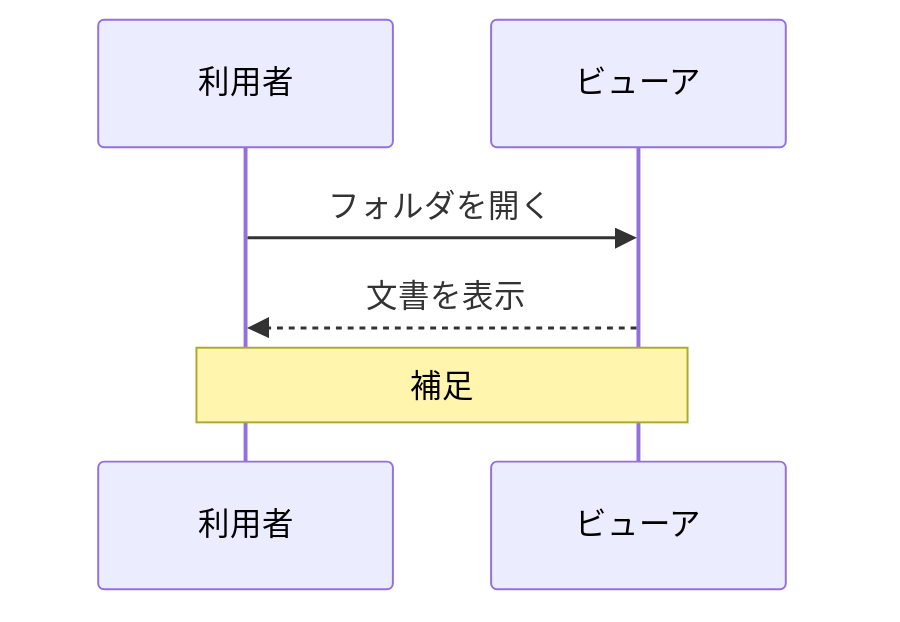

# 表示部品の一覧

配色とアクセシビリティの確認に使う文書です。[存在するリンク](other.md) と [存在しないリンク](none.md)、`インラインコード`、<kbd>Ctrl</kbd> + <kbd>K</kbd>、~~取り消し線~~、**強調**、*斜体* を含みます[^1]。

## 見出し 2

### 見出し 3

#### 見出し 4

> 引用文です。引用の中にも [リンク](other.md) があります。

- 箇条書き
  - 入れ子の項目
- [x] 完了したタスク
- [ ] 未完了のタスク

1. 番号付き
2. リスト

---

> [!NOTE]
> 補足の本文。

> [!TIP]
> ヒントの本文。

> [!IMPORTANT]
> 重要の本文。

> [!WARNING]
> 警告の本文。

> [!CAUTION]
> 注意の本文。

## 表

| 項目 | 値 |
| --- | ---: |
| 小さい表 | 1 |

| 列 A | 列 B | 列 C | 列 D |
| --- | --- | --- | --- |
| `column_value_001` | `column_value_002` | `column_value_003` | `column_value_004` |

## コード

```js
// コメント
/** @param {number} x 説明 */
export default class Counter extends Base {
  static #count = 0;
  constructor(name = 'x') { super(); this.name = `${name}-${Counter.#count++}`; }
  async run(x) { const re = /a+b/gi; return x > 1e3 ? null : await fetch(String(x), { method: 'GET' }); }
}
console.log(Math.max(1, 2), true, undefined, Symbol('s'));
```

```html
<!DOCTYPE html>
<div class="box" id="main" data-x='1'>&amp; text <!-- comment --></div>
<style>.box > a:hover { color: #fff; margin: 0 auto !important; }</style>
```

```python
@decorator
class Greeter(Base):
    """ドキュメント文字列"""
    def greet(self, name: str = "world") -> None:
        print(f"Hello, {name}!", 42, 3.14, None, True)  # コメント
```

```diff
--- a/file.txt
+++ b/file.txt
@@ -1,2 +1,2 @@
-削除した行
+追加した行
```

```css
@media (max-width: 600px) { #id .cls::before { content: "\201C"; color: rgb(0 0 0 / 50%); width: calc(100% - 2rem); } }
```

```json
{ "name": "mdfolio", "version": 1, "ok": true, "none": null, "list": [1.5, "two"] }
```

```bash
#!/usr/bin/env bash
set -euo pipefail
for f in *.md; do echo "$f" | sed -e 's/a/b/' > "${f%.md}.txt"; done
```

```yaml
key: value
list:
  - item: 1
  - &anchor other: "text" # comment
```

```sql
SELECT id, COUNT(*) AS n FROM docs WHERE title LIKE '%md%' GROUP BY id HAVING n > 1; -- comment
```

```markdown
# 見出し
**強調** と *斜体*、`code`、[リンク](https://example.com)
> 引用
- 項目
```

```
言語の指定がないコード
```

## 数式と図

インライン $a^2 + b^2 = c^2$ と、誤りのある数式 $\frac{1}{$ です。

$$
\int_0^1 x^2 \, dx = \frac{1}{3}
$$





## 画像と折りたたみ


<details>
<summary>折りたたみの見出し</summary>

折りたたみの中身。

</details>

[^1]: 脚注の本文。
