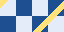
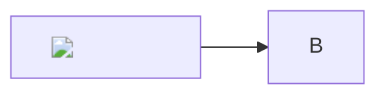

# XSS テスト

<script>window.__xss = (window.__xss || 0) + 1;</script>


<svg onload="window.__xss = 1"><script>window.__xss = 1</script></svg>

<iframe src="javascript:window.parent.__xss = 1"></iframe>

<a href="javascript:window.__xss = 1" id="js-link">javascript リンク</a>

[markdown js](javascript:window.__xss=1)

<a href="data:text/html,<script>window.__xss = 1</script>" id="data-link">data リンク</a>

<form action="https://example.invalid/steal"><input name="q" value="secret"><button>送信</button><textarea>t</textarea><select><option>o</option></select></form>

<style>body { display: none !important; } .mdv-header { display: none !important; }</style>

<div id="overlay" style="position: fixed; inset: 0; background: url(https://example.invalid/track.png); z-index: 99999; color: green">overlay</div>

<div id="mdv-root">clobber root</div>

<a id="mdv-main" name="mdv-main">clobber main</a>



<button class="mdv-copy" onclick="window.__xss = 1">偽のコピー</button>

<span class="mdv-toast extra-class">偽の通知</span>

<details open ontoggle="window.__xss = 1"><summary>toggle</summary>x</details>

<video src="https://example.invalid/v.mp4" poster="https://example.invalid/poster.png" autoplay onloadstart="window.__xss = 1"></video>

<audio src="https://example.invalid/a.mp3" autoplay></audio>


<table background="https://example.invalid/bg.png"><tr><td background="https://example.invalid/bg2.png">cell</td></tr></table>

<a href="https://example.invalid/ping" ping="https://example.invalid/ping-target" id="ping-link" target="_top">ping</a>

<link rel="stylesheet" href="https://example.invalid/x.css">

<meta http-equiv="refresh" content="0; url=https://example.invalid/">

<base href="https://example.invalid/">

<object data="https://example.invalid/o.swf"></object>

<embed src="https://example.invalid/e.swf">

<input type="image" src="https://example.invalid/input.png">

<input type="text" value="text input">

<math><mtext></mtext></math>

<a href="\\example.invalid\share\file" id="unc-link">UNC</a>

<a href="file:///etc/passwd" id="file-link">file</a>

<a href="//example.invalid/protocol-relative" id="pr-link">protocol-relative link</a>

<a href="ftp://example.invalid/x" id="ftp-link">ftp</a>

<map name="m"><area href="https://example.invalid/area" shape="rect" coords="0,0,10,10"></map>

<p contenteditable="true" tabindex="0" data-secret="1" id="attrs">属性</p>

```html
<script>window.__xss = 1</script>
```

`<script>window.__xss = 1</script>`

$\href{javascript:window.__xss=1}{math link}$


